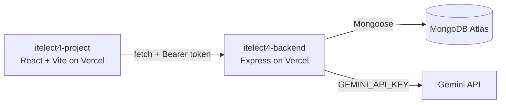

# itelect4-project1-it4c

[](https://github.com/jmikhaela/itelect4-project1-it4c/actions/workflows/ci.yml)

The frontend client for the Peer Tutoring Management platform (ITELECT4): React + Vite, TypeScript, Tailwind CSS, TanStack React Query, React Router, React Hook Form, and Zod.

- **Backend API:** https://itelect4-backend-plum.vercel.app
- **Backend repo:** https://github.com/jmikhaela/itelect4-backend

## Architecture



## Run it locally

```bash
npm install
npm run dev      # http://localhost:5173
npm test         # Vitest component, hook, and form validation tests
npm run build    # tsc -b && vite build
```

## AI-use disclosure

AI tools (Antigravity AI / Claude) were used as coding assistants during Session 12 to help generate test suites (`src/components/BookingBadge.test.tsx`, `src/hooks/UseToggle.test.ts`, `src/pages/LoginPage.test.tsx`), structure the GitHub Actions CI pipeline (`.github/workflows/ci.yml`), and configure `vite.config.ts` and `package.json` test scripts. All code, routes, and tests have been reviewed and verified for correctness.
